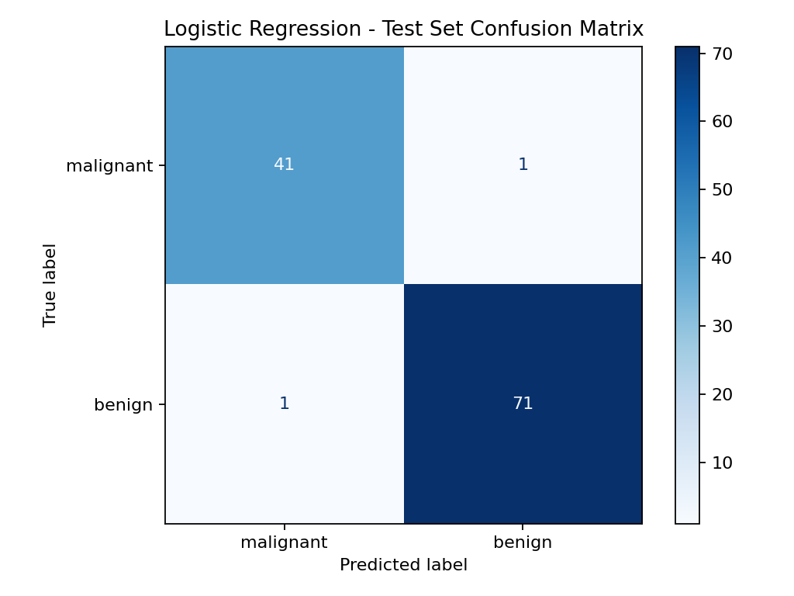

# Breast Cancer Classification

The pipeline predicts whether a breast mass is **malignant** or **benign** using measurements computed from digitized fine-needle aspirate images.

## Results

<details>
<summary>Held-out test performance</summary>

| Metric | Result |
|---|---:|
| **Test accuracy** | **98.25%** |
| Test samples | 114 |
| Correct predictions | 112 / 114 |

Confusion matrix (rows = actual class, columns = predicted class; class order: malignant, benign):

| | Predicted malignant | Predicted benign |
|---|---:|---:|
| Actual malignant | 41 | 1 |
| Actual benign | 1 | 71 |

Per-class results:

| Class | Precision | Recall | F1-score |
|---|---:|---:|---:|
| Malignant | 0.98 | 0.98 | 0.98 |
| Benign | 0.99 | 0.99 | 0.99 |

</details>



These results come from one stratified 80/20 train-test split with `random_state=42`. They are a reproducible class-project result, not a claim of clinical performance.

## Dataset

- **Name:** Breast Cancer Wisconsin (Diagnostic)
- **Source:** `sklearn.datasets.load_breast_cancer()`
- **Size:** 569 samples, 30 numeric features
- **Target:** malignant (0) or benign (1)
- **Access:** bundled with scikit-learn; no download, API key, or separate data file required

## Model and workflow

1. Load the built-in dataset.
2. Split into 80% training data and 20% test data using stratification.
3. Standardize features with `StandardScaler`.
4. Train `LogisticRegression` (`max_iter=1000`).
5. Evaluate once on the held-out test set using accuracy, precision, recall, F1-score, and a confusion matrix.
6. Save metrics to `outputs/metrics.json` and the confusion matrix plot to `outputs/confusion_matrix.png`.

The scaler and classifier are combined in a scikit-learn `Pipeline`, so scaling is fit only on the training data and there is no preprocessing leakage from the test set.

## Run locally

```bash
# 1. Clone the repository and enter the project folder
 git clone <your-repository-url>
 cd breast-cancer-ml-pipeline

# 2. Create and activate a virtual environment (optional but recommended)
python -m venv .venv
source .venv/bin/activate        # macOS/Linux
# .venv\Scripts\activate       # Windows

# 3. Install dependencies
pip install -r requirements.txt

# 4. Train and evaluate
python train.py
```

The script prints the evaluation results and regenerates the files in `outputs/`.

## Repository structure

```text
breast-cancer-ml-pipeline/
├── outputs/
│   ├── confusion_matrix.png
│   └── metrics.json
├── .gitignore
├── README.md
├── requirements.txt
└── train.py
```

## Limitations

This is a compact educational demonstration. The test set is relatively small, performance can vary with a different split, and the dataset is not a substitute for clinical validation. The model should not be used to diagnose or guide medical decisions.

## Reproducibility

- Split seed: `42`
- Test fraction: `0.20`
- Model: standardized logistic regression
- Dataset: scikit-learn built-in Breast Cancer Wisconsin (Diagnostic)
